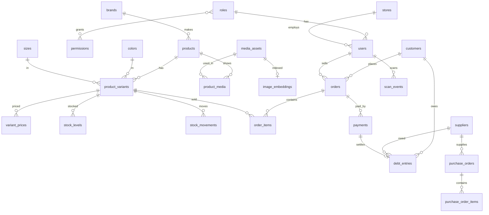

# Thiết kế database cho cửa hàng quần áo (ScanIt + Jupiter POS)

Schema đang dùng: `src/main/resources/db/migration/V1__init.sql` (Flyway, cần extension `pg_trgm`). Bản đầy đủ kèm bảng vector cho quét ảnh: `docs/schema-full.sql` (cần `pgvector`; migration tương ứng ở `src/main/resources/db/optional`).
Đã chạy thử trên PostgreSQL 16 thật: tạo bảng thành công, luồng bán nợ rồi thu nợ cho số dư đúng, và 9 trường hợp dữ liệu sai đều bị chặn.
Phần `pgvector` (bảng `image_embeddings`) chưa chạy thử được vì máy kiểm tra không có extension này, hãy chạy thử khi cài lên server của bạn.

## 1. Điều mình thấy trong BE `jupiter_pos_be`

| Có sẵn | Ghi chú |
|---|---|
| Spring Boot 3.4, Java 17, PostgreSQL, JWT, Liquibase, WebSocket | Giữ nguyên làm backend |
| Sản phẩm, biến thể, thuộc tính, đơn vị | Biến thể dùng thuộc tính tự do (EAV), chưa hợp với quần áo |
| Đơn hàng, thanh toán, khách hàng, thống kê, thông báo | Dùng lại được phần lớn |
| Ảnh qua Cloudinary | Lưu đường dẫn ảnh theo từng biến thể |
| Phân quyền | Chỉ là cột `role` (`ADMIN`/`EMPLOYEE`), chưa có bảng quyền |
| Công nợ | **Chưa có.** Chỉ có một câu thống kê `total_debt = tổng đơn - tổng đã trả` |

### Cần xử lý gấp: bảo mật

Repo `jupiter_pos_be` là **public** và file `application.properties` đang chứa giá trị thật của: Cloudinary API secret, mật khẩu email SMTP, Twilio auth token, JWT secret, và số tài khoản ngân hàng VietQR. Thư mục `node_modules/` (khoảng 134 MB) cũng đã bị commit.
Xoá file khỏi nhánh hiện tại là chưa đủ vì lịch sử git vẫn còn. Cần làm theo thứ tự:

1. Đổi (rotate) toàn bộ secret trên: Cloudinary, mật khẩu email, Twilio, JWT secret.
2. Chuyển các giá trị đó sang biến môi trường (`${CLOUDINARY_API_SECRET}`...), như phần `DATABASE` đã làm.
3. Xoá `node_modules/` khỏi repo, thêm `.gitignore`, rồi xoá secret khỏi lịch sử bằng `git filter-repo` hoặc BFG.

Ngoài ra `spring.jpa.hibernate.ddl-auto=update` đang chạy cùng Liquibase, hai thứ này sẽ đánh nhau khi đổi schema. Nên đặt thành `validate` và chỉ để Liquibase đổi schema.

## 2. Các quyết định thiết kế chính

**Sản phẩm → biến thể = màu × size.** `products` là mẫu mã (vd. set 8922#), `product_variants` là một màu + một size cụ thể, có SKU, mã vạch và tồn kho riêng. Ràng buộc `UNIQUE (product_id, color_id, size_id)` ngăn tạo trùng. Set nhiều món ghi trong `products.components` (áo khoác, áo ba lỗ, chân váy), tồn kho tính theo cả set.

**Giá sỉ và giá lẻ.** Bảng `variant_prices` cho phép nhiều mức giá, có thể theo số lượng tối thiểu. Mình đoán "Buôn 410" trong caption của bạn là giá sỉ 410.000đ, nhưng chưa chắc (xem phần 6).

**Tồn kho là sổ cái.** `stock_levels` giữ số hiện tại, `stock_movements` ghi mọi lần nhập, bán, trả, kiểm kho với `balance_after`. Muốn biết tồn lệch vì đâu thì tra sổ này.

**Công nợ là sổ cái chỉ thêm, không sửa.** `debt_entries` mỗi dòng là một lần nợ tăng (số dương) hoặc giảm (số âm). `customers.current_debt` là số cache, bằng tổng sổ cái. `payments` là tiền thật thu/chi. Có `credit_limit` để chặn bán nợ quá hạn mức, và công nợ nhà cung cấp dùng chung cấu trúc.

**Phân quyền thật.** `users → roles → permissions` (mã dạng `product.manage`, `debt.collect`...). Admin tạo thêm vai trò trên web (vd. "Thủ kho", "Kế toán") mà không cần sửa code. Có sẵn 16 quyền, `ADMIN` có tất cả, `EMPLOYEE` có 6 quyền: quét, xem sản phẩm/tồn, xem và tạo đơn, xem khách. `audit_logs` ghi ai đã đổi gì.

**Đơn vị tiền** là `BIGINT` VND, giống BE hiện tại, tránh lỗi làm tròn số thập phân.

## 3. Lưu ảnh: DB không giữ ảnh, chỉ giữ khoá + thông tin

Bảng `media_assets` lưu `object_key` (đường dẫn trên storage), kích thước, `sha256` và `blurhash`. File ảnh nằm ở object storage và phục vụ qua CDN.

Cách tiết kiệm dung lượng:

- **Nén trước khi upload.** Thu nhỏ còn 1200px chiều rộng, đổi sang WebP. Mình đã đo trên 3 ảnh thật của shop: tổng **3.333 KB → 387 KB** (giảm 88%), kèm ảnh thu nhỏ 320px chỉ ~11 KB mỗi ảnh.
- **Không lưu trùng.** `sha256` là `UNIQUE`: cùng một ảnh upload lại chỉ dùng chung một file.
- **Gắn ảnh theo (sản phẩm + màu)**, không gắn theo size. Đổi size thì ảnh không đổi nên không phải lưu lại.
- **Danh sách dùng ảnh thumbnail**, chỉ trang chi tiết mới tải ảnh lớn. `blurhash` hiện nền mờ trong lúc ảnh đang tải.

Cột `storage_provider` cho phép đổi nhà cung cấp mà không đổi cấu trúc DB (đã khai báo `CLOUDINARY`, `R2`, `S3`, `OCI`, `LOCAL`).

## 4. Quét ảnh chưa đúng: nguyên nhân và cách sửa

**Nguyên nhân.** Chế độ Photo hiện tại là hàm giả: `recognizeProductFromImage()` không nhìn vào ảnh, chỉ chọn ngẫu nhiên một sản phẩm. Vì vậy kết quả sai là đúng như thiết kế hiện tại, không phải lỗi camera.

**Cách làm thật.** Mỗi ảnh sản phẩm được biến thành một vector 512 chiều bằng mô hình thị giác (CLIP/SigLIP), lưu ở `image_embeddings`. Khi nhân viên chụp, server tạo vector cho ảnh vừa chụp rồi tìm các vector gần nhất bằng `pgvector`. Kết quả trả về **3 ứng viên kèm độ giống**, nhân viên bấm chọn đúng cái, lựa chọn đó ghi vào `scan_events.confirmed_variant_id`.

**Giới hạn nên biết trước:**

- Ba màu của set 8922# cùng kiểu dáng, chỉ khác màu. Mô hình nhận ra kiểu dáng khá tốt nhưng có thể nhầm giữa màu xám than và nâu đậm khi ánh sáng yếu. Vì vậy phải hiện ứng viên cho nhân viên xác nhận, không tự động chọn.
- Quần áo treo, gấp hay mặc lên người trông rất khác ảnh studio. Mỗi màu nên có 3-5 ảnh nhiều góc.
- Với cửa hàng quần áo, **tem mã vạch in sẵn trên từng món là cách chính xác nhất**. Nên coi quét ảnh là công cụ phụ khi mất tem hoặc khách chỉ cho xem ảnh.
- Cần chạy mô hình ở server (Python hoặc dịch vụ ngoài), không chạy được ngay trong Expo Go.

`scan_events` ghi lại mọi lần quét nên sau vài tuần bạn có số liệu thật về tỷ lệ đúng để quyết định có cần cải thiện thêm không.

## 5. Kế hoạch: BE hiện có → web admin + mobile

Đã chốt tách repo: repo này là backend (Spring Boot), app mobile (Expo) ở repo `ScanIt` chỉ gọi API, web admin (React) sẽ là repo riêng.

| Tính năng | Từ BE hiện có | Việc cần làm |
|---|---|---|
| Đăng nhập JWT | Dùng lại | Thêm danh sách quyền vào token |
| Nhân viên | Mở rộng | Đổi cột `role` thành `role_id`, thêm CRUD vai trò và quyền |
| Hàng hoá | Làm lại một phần | Chuyển biến thể sang màu × size, thêm giá sỉ/lẻ |
| Ảnh | Mở rộng | Thêm nén ảnh, chống trùng, `media_assets` |
| Đơn hàng, thanh toán | Dùng lại | Thanh toán ghi vào sổ công nợ |
| Công nợ | **Làm mới** | Sổ công nợ khách và nhà cung cấp, thu nợ, hạn mức |
| Quét mã vạch / ảnh | **Làm mới** | API `/scan/barcode/{code}` và `/scan/photo` |
| Thống kê, thông báo | Dùng lại | Giữ nguyên |

Thứ tự làm đề xuất: (1) schema và migration Liquibase + xử lý bảo mật, (2) API hàng hoá, quét mã vạch và đăng nhập cho mobile, (3) web admin: hàng hoá, nhân viên, phân quyền, (4) công nợ, (5) quét ảnh thật.

## 6. Những điểm cần bạn xác nhận

- "OI" là dịch vụ lưu ảnh nào? (xem câu hỏi bên dưới)
- "Buôn 410" là giá sỉ 410.000đ đúng không? Trong app mình đang để tạm 350.000đ cho cả ba màu, đó là số mình tự đặt, không phải giá thật.
- Cấu trúc repo: gộp backend vào repo `scanit`, hay để riêng repo `jupiter_pos_be` và chỉ sửa trong đó?
